# Backsplice

## 1. Introduction

*Note: This document was produced post-hoc from a combination of memory,
reading the code, and using other information from the Git repository. This
document serves as a foundation from which to make improvements to the design.
As such, some sections of the document -- particularly section 6 -- are
intentionally excessively detailed.*

Backsplice is a software program intended for use in Boy Scout camps that use
Doubleknot to register scouts for merit badge courses. Backsplice processes the
output from Doubleknot to create rosters for each merit badge course.
Instructors can use the rosters to track the progress of each scout throughout
the week.

## 2. Constraints

- Must run on Windows

## 3. Context and Scope

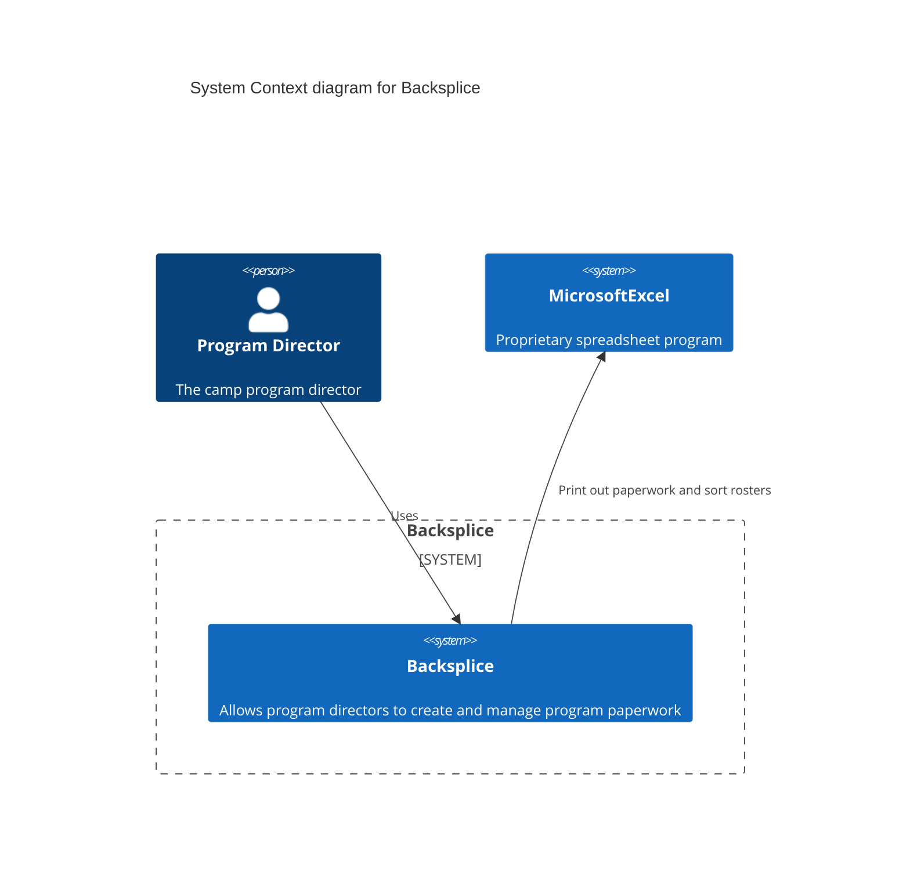

## 4. Solution Strategy

Implement Backsplice in C# .NET. The .NET platform is a Microsoft product and
makes it easy to integrate with other Microsoft products such as Excel. Using
Excel via COM interop makes it easy to print out the paperwork spreadsheets
which is a key feature of Backsplice.

## 5. Building Block View

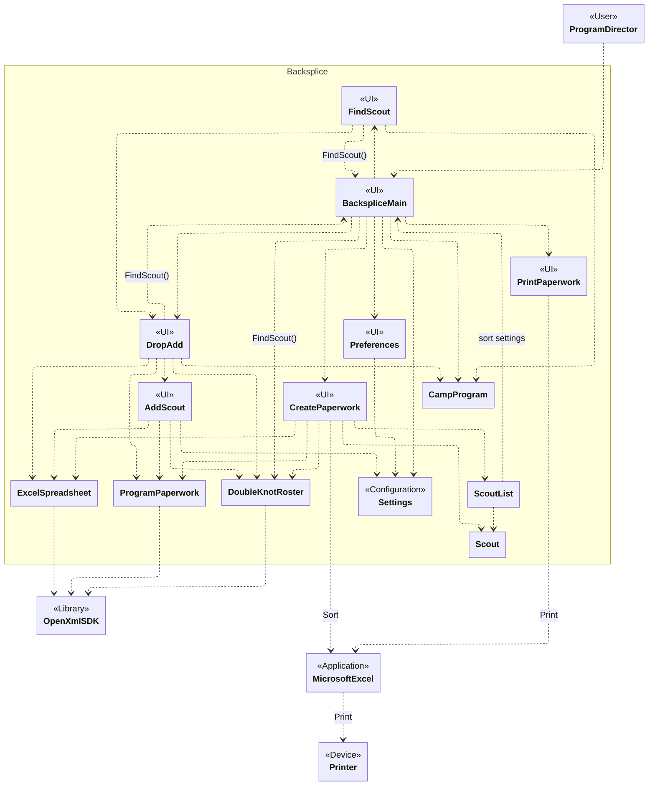

- **BackspliceMain** is the main screen of Backsplice. The user reaches all
  functionality through this screen. It also provides the application's
  settings, through static properties, and the scout search used by Find Scout
  and Drop/Add (6.3.1).
- **CreatePaperwork, PrintPaperwork, FindScout, DropAdd, AddScout, and
  Preferences** are the dialogs for each feature. Each implements its feature
  directly, including its file handling and business rules (8.8).
- **DoubleKnotRoster, ProgramPaperwork, and ExcelSpreadsheet** read and write
  the roster copy, filled paperwork templates, and plain spreadsheets with the
  OpenXML SDK (8.2). They hide how values are stored and parsed in the files,
  but callers address the data by row and sheet (8.2, 8.3).
- **Scout, ScoutList, and CampProgram** hold scouts and registrations while a
  feature works with them (8.5). ScoutList sorts itself according to the sort
  settings (8.6).
- **Settings** is the .NET application settings class, read mostly through
  BackspliceMain and changed in Preferences (8.7).
- **Microsoft Excel** is used through COM Interop to sort the roster copy and
  to print paperwork (8.2, 9.3).

## 6. Runtime View

This section describes the runtime view of each feature of Backsplice.

The scenarios below follow the intended weekly workflow: the program director
exports the week's registrations from Doubleknot, paperwork is created from
the export (6.1), registrations are corrected with Drop and Add (6.4, 6.5),
and the paperwork is printed (6.2). Find Scout (6.3) can be used at any point
after paperwork is created. Backsplice does not enforce this order.

### 6.1 Create Paperwork

The diagrams in this section show the classes and method calls that implement
the create paperwork feature from the perspective of the CreatePaperwork class
that coordinates the process. With the exception of three private methods of
the CreatePaperwork class: fillRegularTemplate, fillDefaultTemplate, and
fillExcelSpreadsheet, which are included for readbility, most of the
unimportant details have been suppressed.

The diagram below is the top level method that drives the entire process.

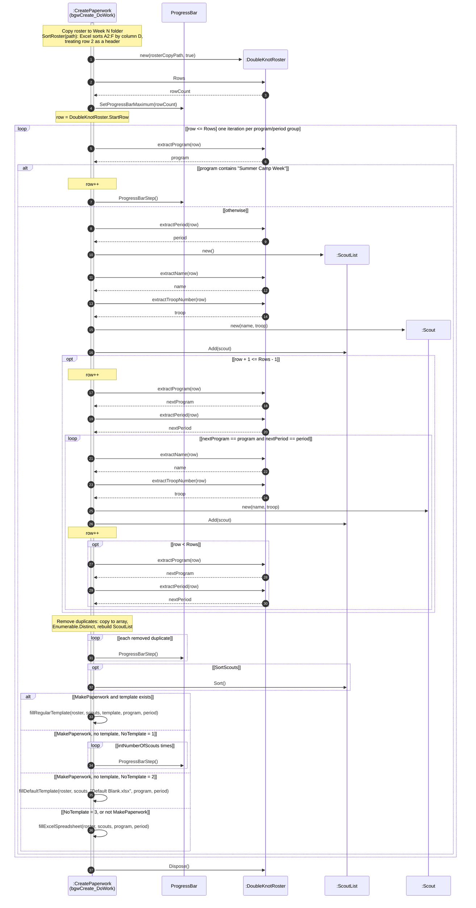

#### 6.1.1 Fill Regular Template

The diagram below shows the flow when there exists a paperwork template for the
given program. The roster parameter is passed in but not used.

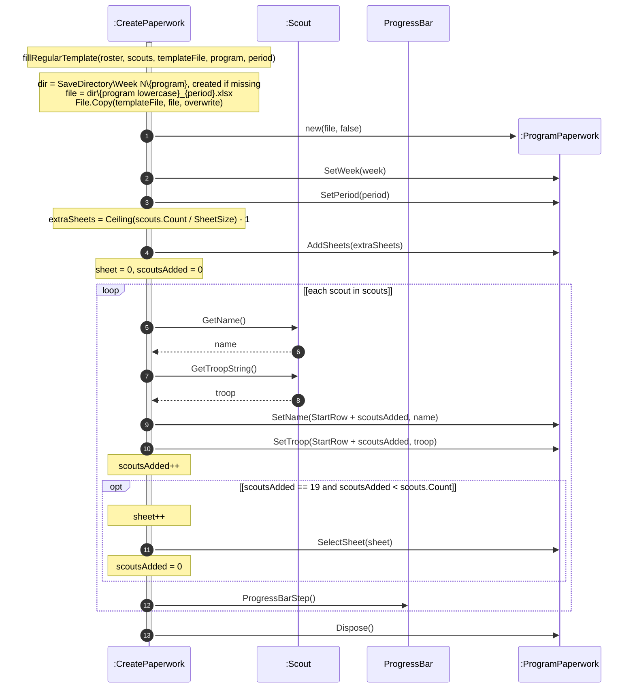

#### 6.1.2 Fill Default Template

The diagram below shows the flow when no template exists for the program and
the default blank template is used. The blank template is filled exactly like a
regular template (see 6.1.1), then the saved workbook is reopened to write the
program name.

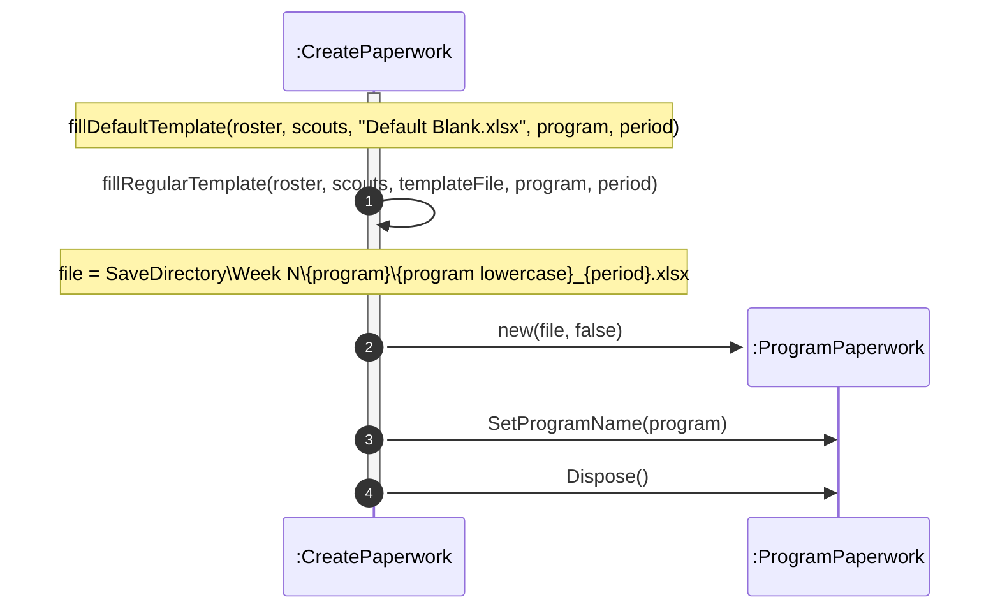

#### 6.1.3 Fill Excel Spreadsheet

The diagram below shows the flow when Backsplice has been configured to produce
simple lists instead of paperwork, or when Backsplice has been configured to
produce a simple list when no template exists for a program instead of filling
the blank template. The roster parameter is passed in but not used.

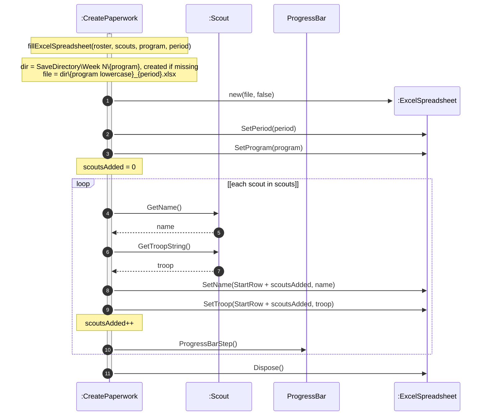

### 6.2 Print Paperwork

The diagram below shows the flow when the user clicks Print (button or menu).
Printing runs synchronously on the UI thread. The user's choices of week,
program, and period are read from the form's combo boxes, and the program list
for the "All" cases is taken from the items in the program combo box. Paperwork
files are found by listing the week's folders and filtering on file name.

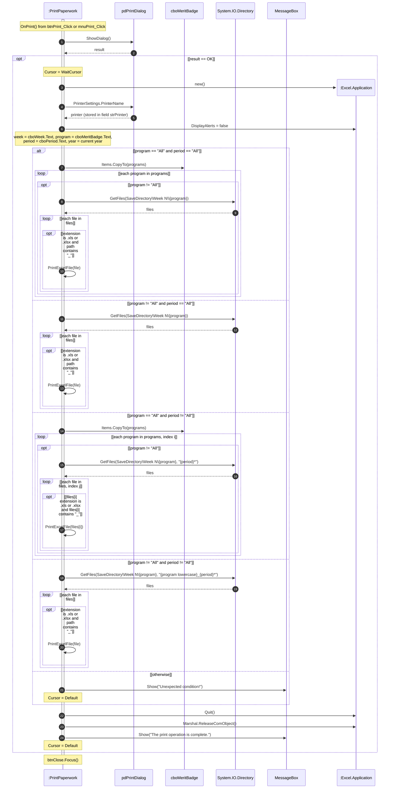

#### 6.2.1 Print Excel File

The diagram below shows how a single paperwork file is printed. The Excel
application and the printer name are not passed in. They are read from fields
that OnPrint set before the first call.

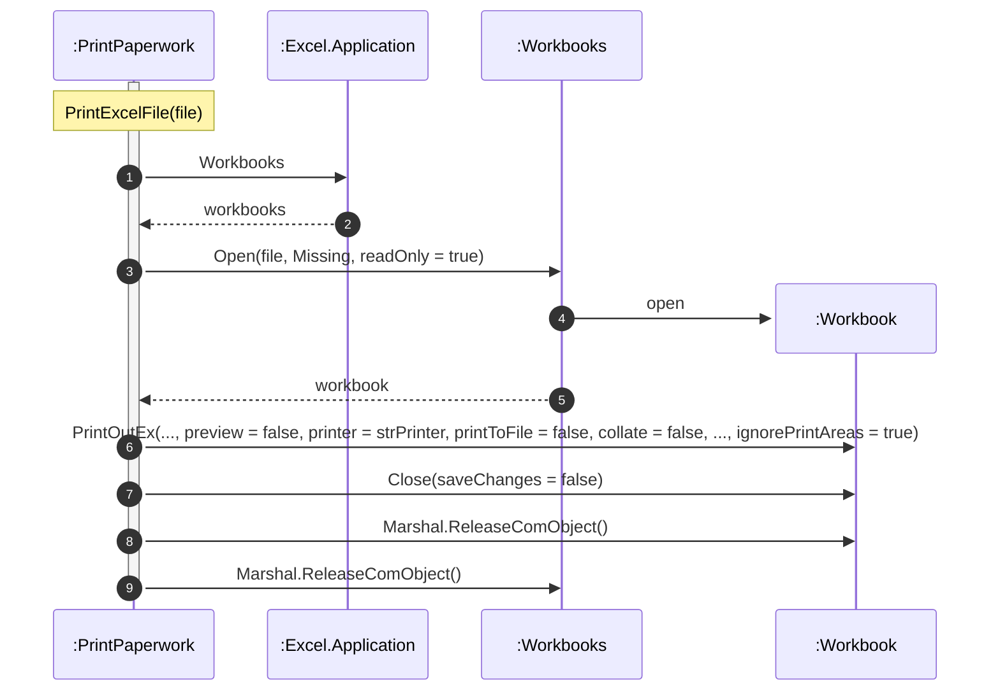

### 6.3 Find Scout

The diagram below shows the flow when the user searches for a scout. OnFind
runs on the UI thread from the Find button or menu item, and again after the
Drop/Add dialog closes. The search itself is delegated to the static method
BackspliceMain.FindScout (see 6.3.1), and the results are shown in the
dgvMeritBadges grid.

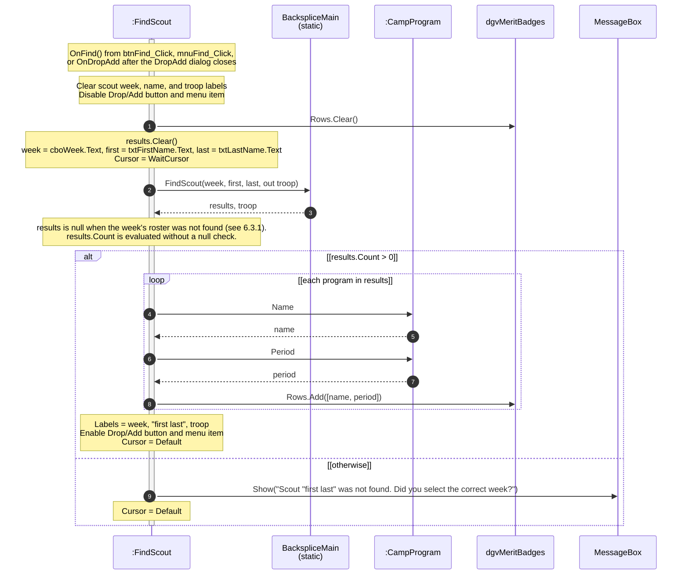

#### 6.3.1 Search Roster for Scout

The diagram below shows how BackspliceMain.FindScout searches the week's copy of
the Doubleknot roster. The roster is located by file name in the week's folder,
following the naming used when paperwork is created (see 6.1). Each matching
roster row becomes a CampProgram, which is inserted into the results in period
order: "All" periods first, numbered periods in ascending order, and anything
else at the end. The troop number is taken from the first matching row.
Duplicate registrations are then removed, keeping the first of each, so the
period order is preserved. If the roster cannot be found, the method shows a
message box and returns null.

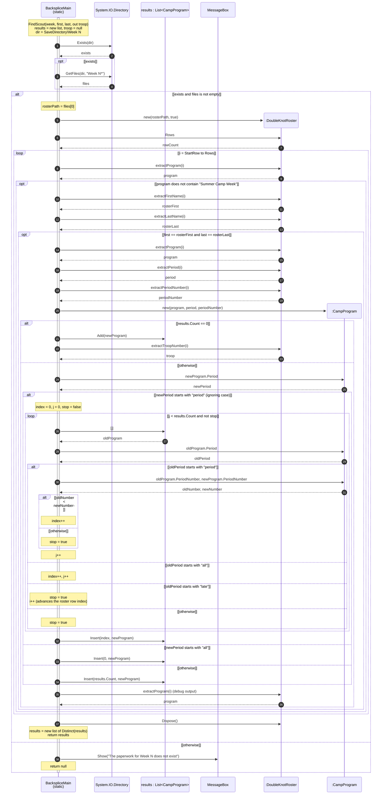

### 6.4 Drop Program

The diagram below shows the flow when the user drops the selected program for
the scout shown in the Drop/Add dialog. OnDrop runs on the UI thread from the
Drop button, the Drop menu item, or a double-click on a grid cell. The scout's
week, name, and troop are read back from the dialog's labels, and the program
and period from the selected grid row. The scout is removed from the week's
roster copy first (see 6.4.1), then from the program's paperwork file
(see 6.4.2).

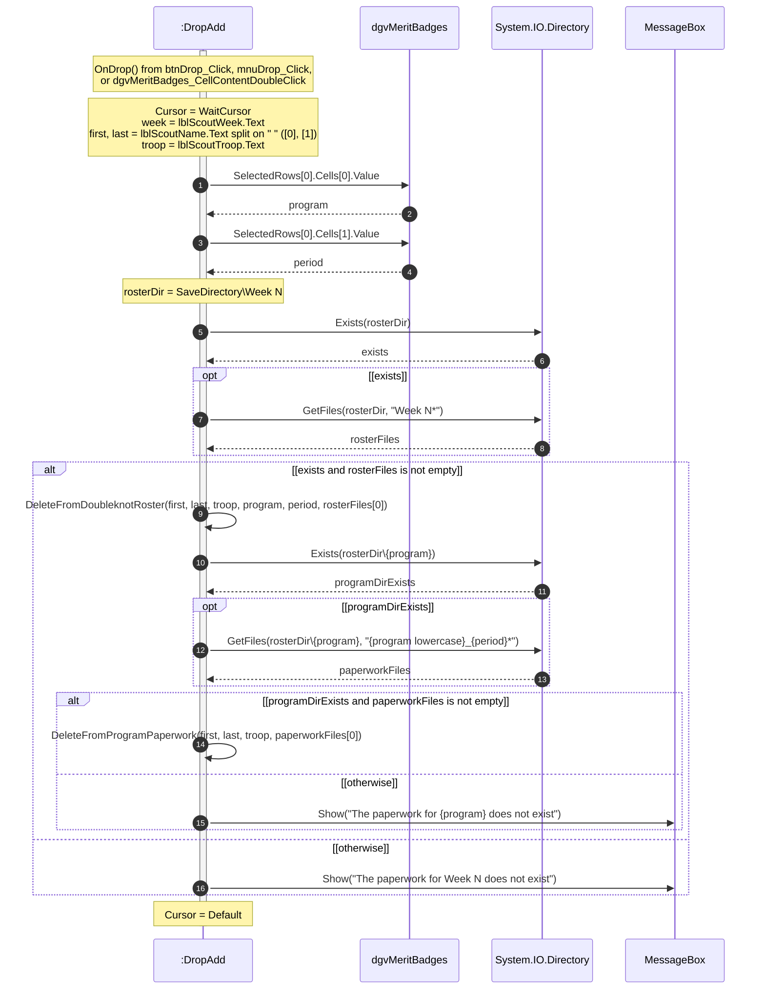

#### 6.4.1 Delete from Doubleknot Roster

The diagram below shows how the scout's row for the dropped program is removed
from the week's copy of the Doubleknot roster. Every row is checked, and every
row matching all five values is removed. The row count is re-read each time
the loop condition is tested. After the roster is closed, the selected row is
removed from the dialog's grid.

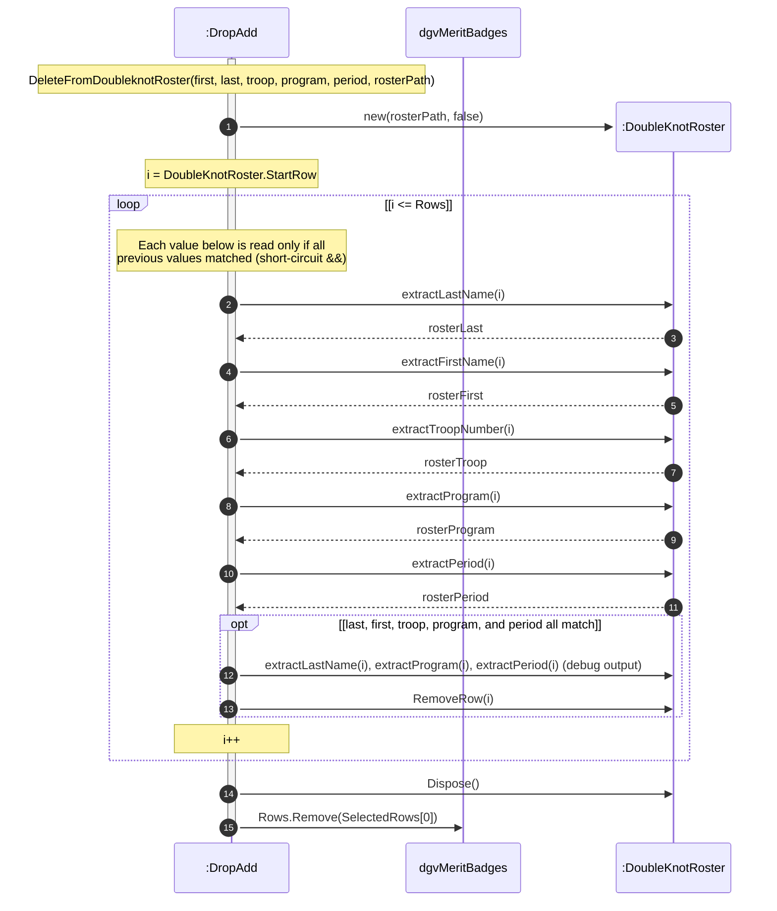

#### 6.4.2 Delete from Program Paperwork

The diagram below shows how the scout is removed from the program's paperwork
file. The file is either a filled paperwork template or a plain Excel
spreadsheet (see 6.1), and the method checks which before opening it. The
search stops at the first row that matches. In a plain spreadsheet the name is
compared in "Last, First" form.

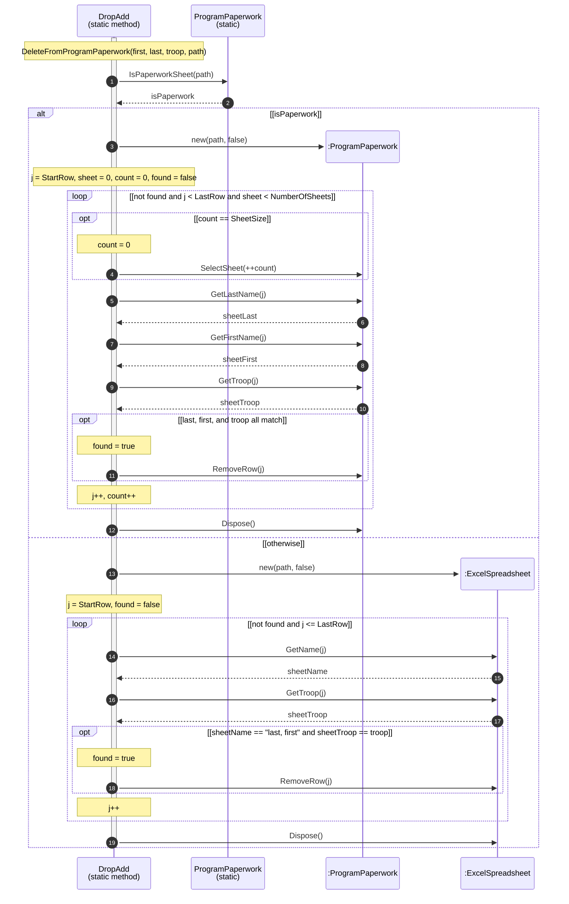

### 6.5 Add Program

The diagram below shows the flow when the scout shown in the Drop/Add dialog
is added to a program. OnAdd runs on the UI thread from the Add button
or menu item. The scout's details are read back from the dialog's labels and
passed to the AddScout dialog, which performs the addition. When AddScout
closes, the Drop/Add dialog searches for the scout again to refresh its
display (see 6.5.1).

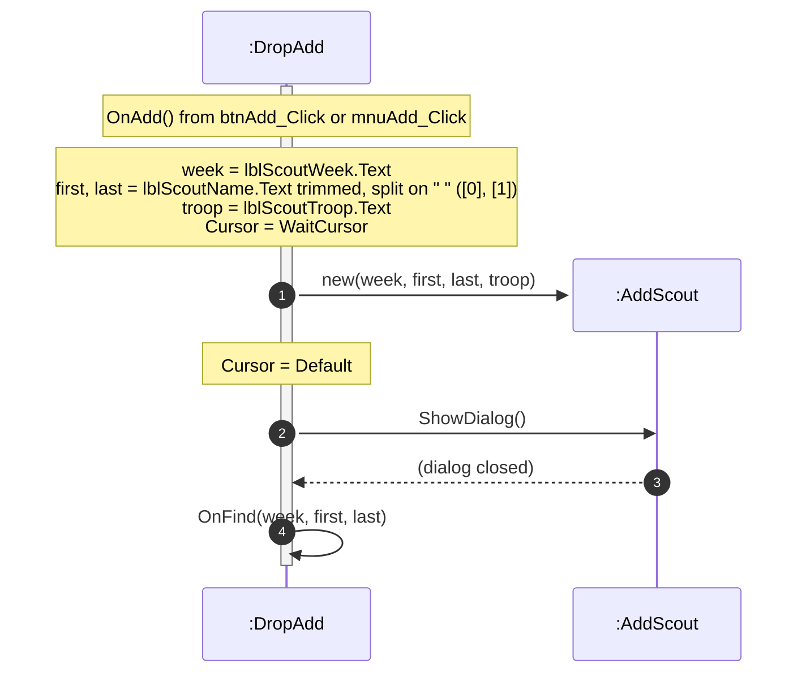

#### 6.5.1 Refresh Scout

The diagram below shows the Drop/Add dialog's own search, used after AddScout
closes and when the user searches from within the Drop/Add dialog. It follows
the same flow as Find Scout (see 6.3) and uses the same search
(BackspliceMain.FindScout, see 6.3.1). It differs in three ways: it takes the
week and name as parameters, it checks for a null result, and on success it
enables Add but leaves Drop disabled until a grid row is selected.

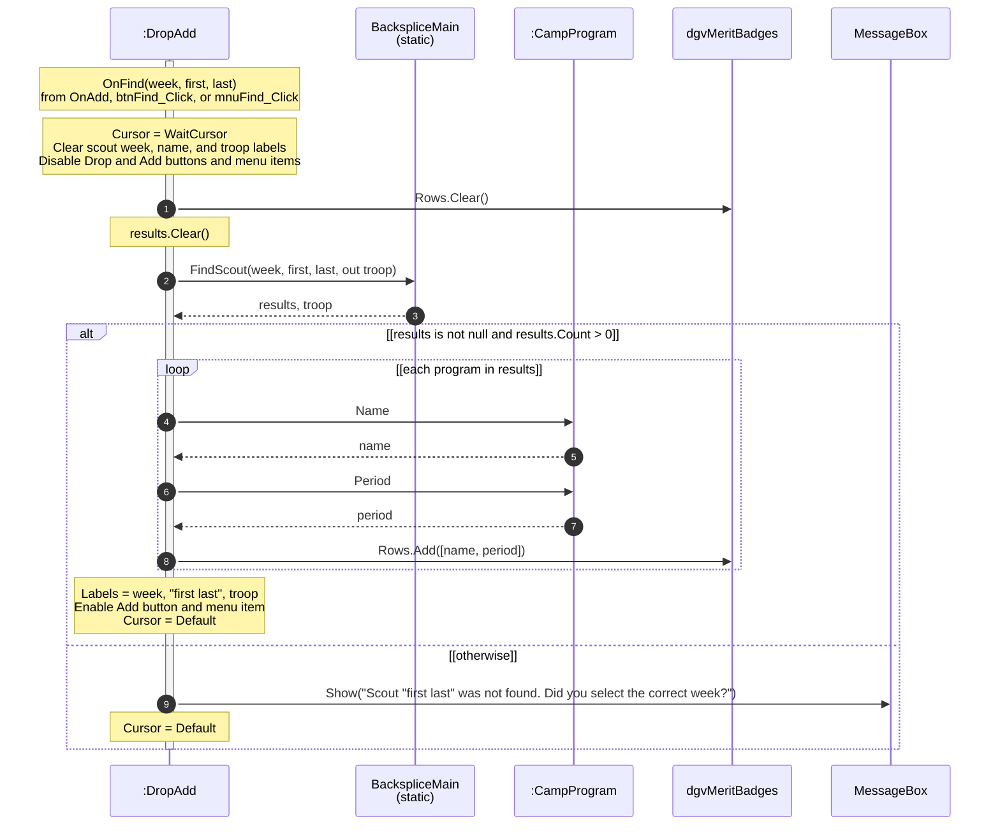

#### 6.5.2 Load Available Programs

The diagram below shows how the AddScout dialog fills its program list when it
loads. It reads the week's roster copy in order and counts consecutive rows
with the same program and period, adding one grid row per group with the
number of registered scouts. Groups whose program contains "Summer Camp Week"
are skipped. The roster path found here is kept in a field and used later by
Add (see 6.5.3).

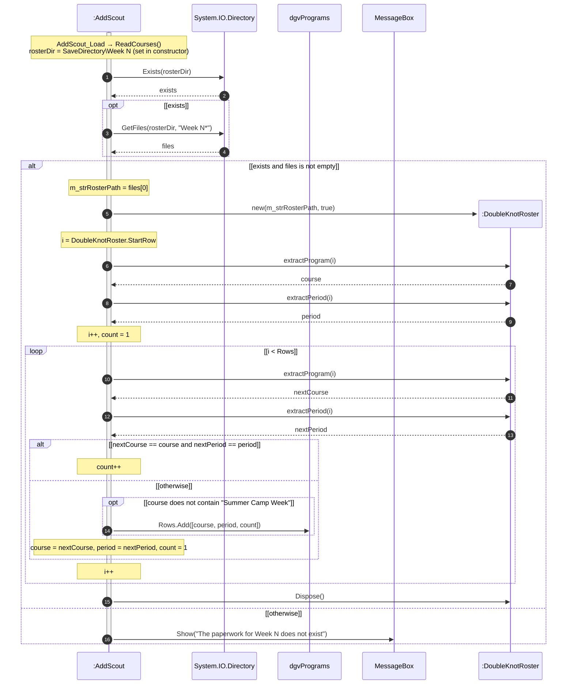

#### 6.5.3 Add Scout to Program

The diagram below shows the flow when the user adds the scout to the selected
program, from the Add button or a double-click on a grid cell. The scout's
name and troop come from the values the Drop/Add dialog passed to the
constructor. The scout is inserted into the week's roster copy first, before
the first existing row in the same program and period whose last name sorts
at or after the scout's. The scout is then inserted into the program's
paperwork file, using one of two procedures depending on the file type
(see 6.5.4 and 6.5.5), and the dialog closes.

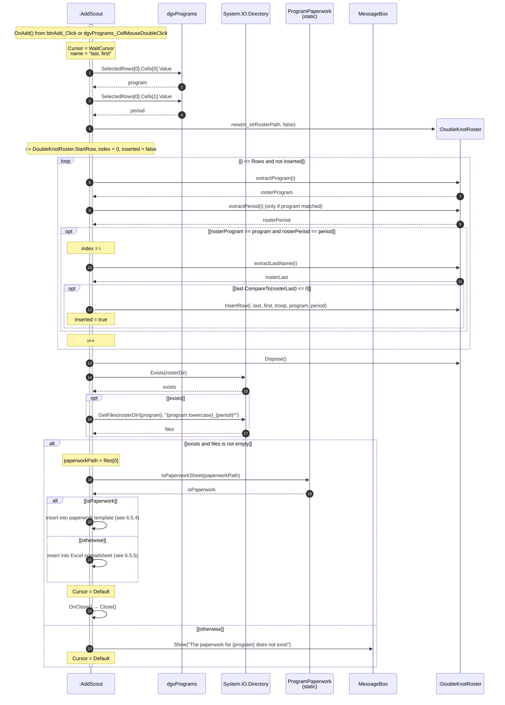

The position where the scout is inserted into the paperwork depends on three
settings. SortScouts is read when the dialog is constructed; SortAlphabetically
and SortByTroop are read directly from the application settings at the time of
the insert. The comparisons below are against the existing row being examined,
with names in "Last, First" form and troops compared as integers. SortScouts
is on whenever either of the other two settings is on (8.7).

| SortScouts | SortAlphabetically | SortByTroop | Insert before the first row where             |
|------------|--------------------|-------------|-----------------------------------------------|
| on         | on                 | on          | name <= row's name and troop <= row's troop   |
| on         | on                 | off         | name <= row's name                            |
| on         | off                | on          | troop <= row's troop                          |
| off        | off                | off         | name <= row's name                            |

#### 6.5.4 Insert into Paperwork Template

The diagram below shows how the scout is inserted into a filled paperwork
template. Each sheet is searched in turn. The scout is written into the first
empty row found, or inserted before the first row that satisfies the position
rule (see the table in 6.5.3), whichever comes first.

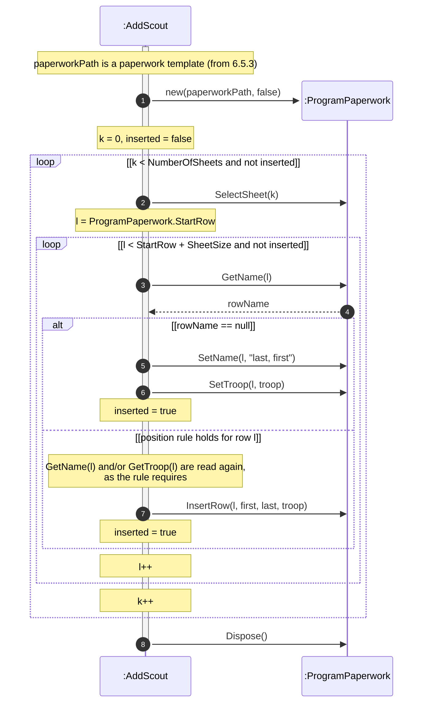

#### 6.5.5 Insert into Excel Spreadsheet

The diagram below shows how the scout is inserted into a plain Excel
spreadsheet. The scout is inserted before the first row that satisfies the
position rule (see the table in 6.5.3). If no row does, the scout is
appended after the last row.

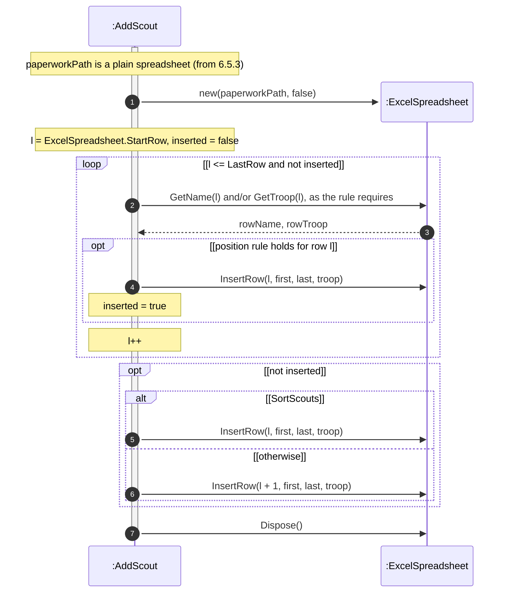

## 7 Deployment View

Backsplice runs on a single Windows computer, the program director's computer
in their office (9.5). Apart from the Doubleknot export, the printer, and the
installer, everything Backsplice uses is on that computer.

### 7.1 Infrastructure

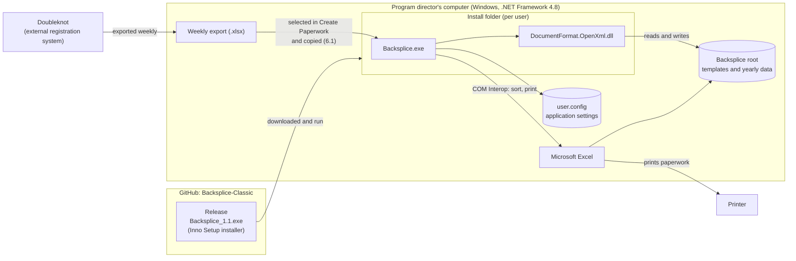

| Element | Description |
| --- | --- |
| Program director's computer | Windows computer in the program director's office, with the .NET Framework 4.8. The only computer Backsplice runs on. |
| Backsplice.exe | The Windows Forms application, targeting the .NET Framework 4.8, installed per user (7.2). |
| DocumentFormat.OpenXml.dll | The OpenXML SDK, version 2.16.0, installed alongside Backsplice.exe. Used to read and write `.xlsx` files (8.2). |
| Microsoft Excel | Must be installed on the same computer. Used through COM Interop to sort the roster copy and to print (8.2, 9.3). The Interop types (Office 2013, version 15) are embedded in Backsplice.exe, so no Interop assembly is installed. |
| Backsplice root | `My Documents\Backsplice` by default, or a location chosen in Preferences (8.1). Holds the default template directory and each year's rosters and paperwork. It is not backed up. |
| Application settings | .NET user settings, saved in a `user.config` file in the user's local application data folder (8.7). |
| Weekly export | The Doubleknot export, saved on the computer by the program director and selected in Create Paperwork. Backsplice copies it into the week's folder (9.4). |
| Printer | Any printer available to Excel on the computer, chosen in the print dialog each time paperwork is printed (6.2). |

### 7.2 Installation

Backsplice is installed with an Inno Setup installer (`src/Setup/backsplice.iss`),
published as a release in the project's GitHub repository. The current version
is 1.1.

- The installer runs without administrator rights and installs for the
  current user only, in the Programs folder of the user's profile.
- It installs Backsplice.exe, Backsplice.exe.config, Backsplice.pdb, and
  DocumentFormat.OpenXml.dll.
- It installs `Default Blank.xlsx` in `My Documents\Backsplice\templates`,
  the default template directory when the default save location is used
  (8.1, 8.4).
- It adds a Start menu shortcut and, optionally, a desktop shortcut, and
  offers to start Backsplice when it finishes.
- It does not install or check for the .NET Framework 4.8 or Excel.
- Program templates are not installed. The program director places them in
  the template directory (8.4).

### 7.3 Build and Release

The solution, `src/Backsplice.sln`, contains the Backsplice application,
a UnitTests project, and a backsplicelib library project. NuGet packages
(DocumentFormat.OpenXml and the Excel Interop package) are restored from
`packages.config`.

Releases are built by the GitHub Actions workflow "Create Draft Release" when
a tag is pushed. It restores and builds the solution with MSBuild in the
Release configuration, compiles the installer with Inno Setup, and creates a
draft GitHub release with the installer attached. The workflow's test step is
commented out.

A second workflow, ".NET Core Desktop", runs on pushes and pull requests to
`master`. It is meant to build a signed MSIX package from
`src/Setup/Setup.wapproj`, which does not exist in the repository.

### 7.4 Requirements on the Computer

- Windows with the .NET Framework 4.8.
- Microsoft Excel, for Create Paperwork (sorting) and Print Paperwork.
- A paperwork template for each program that should get its own paperwork,
  in the template directory, plus `Default Blank.xlsx` if NoTemplate is set to
  2 (8.4, 9.7).
- A printer.

## 8 Cross-cutting Concepts

### 8.1 File System as the Data Store

Backsplice has no database. All state lives in files under a single directory
tree, and each feature locates the files it needs by folder and file name.

**Directory resolution.** The Backsplice root directory is
`My Documents\Backsplice` by default, or `{configured directory}\Backsplice`
when the user chooses another location in Preferences. Paperwork is kept
per calendar year in `{root}\{year}`, referred to in this document as the save
directory. The year is the current calendar year when Backsplice starts. The
default template directory is `{root}\templates`, so it moves with the save
location. The error log path, `{save directory}\error_log.txt`, is defined but
nothing writes to it.

**Layout.**

```
{root}\
├── templates\                         default template directory (8.4)
│   ├── {Program}.xlsx                 one template per program
│   └── Default Blank.xlsx             fallback template
└── {year}\                            save directory
    └── Week {N}\
        ├── Week {N}.xls(x)            copy of the Doubleknot export
        └── {Program}\
            └── {program}_{period}.xlsx  paperwork or plain spreadsheet
```

**Naming conventions.**

| Item | Name | Written by | Found by |
| --- | --- | --- | --- |
| Week folder | `Week {N}` | Create Paperwork | Print, Find, Drop/Add (week lists use the last word of the folder name) |
| Roster copy | `Week {N}` + original extension | Create Paperwork | Find, Drop, Add (first file matching `Week {N}*`) |
| Program folder | program name as extracted from the roster | Create Paperwork | Print, Drop, Add |
| Paperwork file | lower-case program name, `_`, period, `.xlsx` | Create Paperwork | Print, Drop, Add (patterns on `{program}_{period}`); Print's period list uses the text between the first `_` in the path and the following `.` |

Print and the Print period list consider only files ending in `.xls` or
`.xlsx` whose path contains `_`.

**System of record.** Once paperwork has been created, the week's roster copy
and the paperwork files are the system of record. Find reads the roster copy;
Drop and Add change both the roster copy and the program's paperwork file
(see 6.4 and 6.5). The original Doubleknot export is not used again.

Files are opened, changed, and saved within a single operation. There is no
locking; Backsplice assumes a single user.

### 8.2 Spreadsheet Access

Backsplice uses two technologies to work with spreadsheets.

- **OpenXML SDK.** The three wrapper classes, DoubleKnotRoster,
  ProgramPaperwork, and ExcelSpreadsheet, read and write `.xlsx` files
  directly, using the DocumentFormat.OpenXml package, currently version 2.16.0
  (7.1). Excel is not required for these operations.
- **Excel COM Interop.** Used only to sort the roster copy before paperwork is
  created (CreatePaperwork.SortRoster) and to print paperwork
  (PrintPaperwork.PrintExcelFile). Both create an Excel application instance,
  turn off alerts, open the workbook, act on it, close it without further
  changes, and release the COM objects.

**Wrapper classes.**

| | DoubleKnotRoster | ProgramPaperwork | ExcelSpreadsheet |
| --- | --- | --- | --- |
| File | Week's roster copy | Copy of a program template | Created by the class if missing |
| Sheets | First only | All, selected by index | First only |
| Data rows | From row 2 (row 1 is a header) | Rows 13–31 on each sheet | From row 2 (row 1 is `Name`, `Troop`) |
| Columns | A last name, B first name, C troop, D description | A name, B troop | A name, B troop |
| String storage | Shared string table | Inline strings | Inline strings |
| Page header | Not used | Week, period, page x of y | Program and period, page x of y |
| Row count | `Rows`: number of rows, header included | 19 per sheet (`SheetSize`) | `LastRow`: number of rows, header included |

**Shared conventions.**

- A wrapper opens its file in the constructor, read-only or editable. If the
  file was opened for editing, `Dispose()` saves it.
- Callers address data by 1-based row number. Row *n* is the *n*th row
  element in the sheet, so a sheet is expected to have no missing rows.
- Within a row, cells are found by position, except DoubleKnotRoster's
  description cell, which is found by cell reference.
- Inserting or removing a row renumbers every row after it.

### 8.3 Doubleknot Roster Format

The roster is a workbook exported from Doubleknot with a single sheet. Row 1
holds column headers, and each following row is one registration of one
person for one program offering or for the camp week. DoubleKnotRoster
interprets it as follows.

| Column | Header | Content | Interpretation |
| --- | --- | --- | --- |
| A | Last Name | Last name | Used as is (trimmed) |
| B | First Name | First name; missing in some camp-week rows | Used as is (trimmed) |
| C | Group Name (Registration) | Troop, council, and registration ID, such as `Troop 648, NCAC (3777474)`. Provisional campers are marked `Provisional Camper` | `PROVO` if the text contains "provisional" or "provo" (any case); otherwise the first run of digits, which is the troop number |
| D | Description | Program, period, start date and time, and offering ID, such as `Archery MB (period 1) Jun 24 2013 9:00AM (1189432)` | Program: text before the first `(`, with a trailing `MB` or `MBs` removed. Period: text inside the first parentheses. Period number: first whole number in the period, or −1 |

Any further columns in the export are ignored.

Programs include merit badges (`Archery MB`), BSA awards (`Snorkeling BSA`),
and other activities and events (`Brownsea`, `Night Climb`). Periods are
numbered time slots (`period 3`; capitalization varies), combined slots
(`Periods 1 & 2`, `all periods`), or named times (`Thursday Dinner`,
`Wed. Evening`).

Each person registered for the camp week has a row whose description reads
`{camp} Summer Camp Week {n} {date} ({ID})`. Every feature skips these rows.

All values are stored in the workbook's shared string table, and empty cells
are left out of the file. Because columns A–C are found by their position in
the row (8.2), a row with no first name cell is misread; this occurs only in
camp-week rows. Rows inserted by Add have only columns A–D, with the
description written as `{program} MB ({period})`.

### 8.4 Paperwork Files

Each program offering has one paperwork file, which is either a filled
paperwork template or a plain spreadsheet.

**Templates.** Templates are kept in the template directory (8.1, 8.7), one
per program, named `{Program}.xlsx`, plus `Default Blank.xlsx`. Create
Paperwork copies the program's template, falling back according to the
MakePaperwork and NoTemplate settings (8.7, 6.1). A template must provide:

- Names in column A and troops in column B, on rows 13–31, which holds 19
  scouts. Rows 1–31 must all exist, even where empty.
- A page header whose left section contains `Week`, followed later by `Period`.
  From `Week` onward, the left section is rewritten as `Week #_{N}_` and
  `Period #_{period}_`, with a leading "Period" word removed from the period.
  For the blank template, the program name is placed in front of the left
  section.
- A right header section, which is replaced on every sheet with
  "Page x of y".

When a program has more than 19 scouts, sheets are added. Each added sheet is a
copy of the first sheet with rows 13–31 cleared. Inserting a scout into a full
sheet moves its last scout to the top of the next sheet, adding a sheet if
needed. Removing a scout moves the first scout of the next sheet up, and a
sheet left empty is deleted.

**Plain spreadsheets.** Created from scratch by ExcelSpreadsheet: a single
sheet with a `Name`/`Troop` header row, scouts from row 2, a page header with
the program, period, and page number, and column widths fitted to the content.

**Telling them apart.** Drop and Add treat a file as a paperwork template if
its first sheet has a page footer, or it has a shared string table, or it has
more than one sheet (ProgramPaperwork.IsPaperworkSheet). Plain spreadsheets as
written by ExcelSpreadsheet have none of these.

### 8.5 Domain Concepts and Identity

- **Scout.** Identified by first name, last name, and troop. There is no
  other identifier. Names appear in three forms: separate first and last name
  (roster), `Last, First` (paperwork files and Scout), and `First Last`
  (labels in the Find Scout and Drop/Add dialogs).
- **Troop.** A number held as text, or `PROVO` for provisional campers.
- **Program offering.** Identified by program name and period. A period is
  free text from the roster; text starting with "All", "Period", or "Late"
  is significant for ordering (8.6).
- **Domain classes.**
  - *Scout* holds a scout's name as a single `Last, First` string and the
    troop as text, with a numeric form that is 0 when the text is not a
    number. Two Scout objects are equal when their name and troop text match
    exactly; Create Paperwork uses this to remove duplicate registrations
    within an offering.
  - *ScoutList* is a list of Scout objects for one offering, used during
    Create Paperwork. It sorts itself according to the sort settings (8.6).
  - *CampProgram* holds one of a scout's registrations, as program name,
    period, and period number. Two CampProgram objects are equal when all
    three match; Find Scout uses this to remove duplicate registrations from
    its results, keeping the first of each.

### 8.6 Ordering

| Where | What is ordered | Rule |
| --- | --- | --- |
| Create Paperwork (6.1) | Roster copy | Sorted by column D (description), ascending, using Excel, before rows are grouped by program and period. Row 2 is treated as a header and keeps its place (11.1, item 2) |
| Create Paperwork (6.1) | Scouts in an offering | When SortScouts is on, ScoutList.Sort orders them by the sort settings (below) |
| Find Scout (6.3.1) | A scout's registrations | "All" periods first, then numbered periods ascending, then everything else, in roster order within each group |
| Add (6.5.3) | Roster copy | Inserted before the first row of the same offering whose last name sorts at or after the scout's |
| Add (6.5.3–6.5.5) | Paperwork file | By name and/or troop, according to the sort settings (table in 6.5.3) |

ScoutList.Sort reads SortAlphabetically and SortByTroop when it is called:

| SortAlphabetically | SortByTroop | Order |
| --- | --- | --- |
| on | on | Troop number, then name (`Last, First`) within each troop |
| on | off | Name (`Last, First`) |
| off | on | Troop number; order within a troop is unspecified |
| off | off | Not sorted: roster order |

Troop numbers are compared as integers, with non-numeric troops such as
`PROVO` counted as 0. Names are compared using the current culture.

### 8.7 Configuration

Settings are .NET application settings, edited in the Preferences dialog and
saved when the user applies them.

| Setting | Meaning | Set in Preferences |
| --- | --- | --- |
| UseDefaultSaveDirectory, SaveDirectory | Where the Backsplice root is (8.1) | Save location: default or other |
| UseDefaultTemplateDirectory, TemplateDirectory | Where templates are (8.4) | Template location: default or other |
| MakePaperwork | Fill templates (on) or create plain spreadsheets (off) | Create paperwork or spreadsheets |
| NoTemplate | When a program has no template: 1 skip, 2 blank template, 3 plain spreadsheet | No-template action; set to 3 when MakePaperwork is off |
| SortAlphabetically, SortByTroop | Sort keys for scouts | Two check boxes |
| SortScouts | Whether to sort scouts at all | Not set directly: on when either sort check box is on |

On a new installation, both directories are the defaults, MakePaperwork is
on, NoTemplate is 3, and both sort settings are on.

Other directories, a custom save or template location, are validated when
applied: the path must start with one of the computer's drives, and Backsplice
tries to create the directory.

Most code reads settings through static properties of BackspliceMain. AddScout
reads SortAlphabetically and SortByTroop directly from the settings. AddScout
reads SortScouts when the dialog is created. Other code reads settings at the
time of use.

### 8.8 User Interface Conventions

- **Navigation.** The main form opens each feature as a modal dialog: Create
  Paperwork, Print Paperwork, Find Scout, Drop/Add, and Preferences. Print,
  Find, and Drop/Add are enabled only when the save directory contains at
  least one week folder, checked at startup and after Create Paperwork and
  Preferences close.
- **Week selection.** Each dialog lists the existing week folders and accepts
  only a listed week. Typed entries outside 1–8 are rejected.
- **Control state.** Each command is available from both a button and a menu
  item, enabled and disabled together by change handlers on the inputs.
  Invalid entries are highlighted in the InvalidEntry color.
- **Feedback.** A wait cursor during work, a progress bar in Create Paperwork,
  and message boxes for errors and completion.
- **Passing data between dialogs.** Dialogs pass a scout's details through
  constructor arguments, and read them back from their own labels. A dialog
  that opens another refreshes its display by searching again when the child
  closes: Find Scout after Drop/Add, and Drop/Add after Add Scout.

### 8.9 Long-Running Work

Only Create Paperwork runs in the background. It uses a BackgroundWorker,
updates the progress bar through Control.Invoke, and restores the form when
the worker completes (6.1). Print, Find, Drop, and Add run on the UI thread.

### 8.10 Error Handling

Errors are detected by checking for the expected folders and files, and
reported where they are detected with a message box, including from
BackspliceMain.FindScout, which then returns null. Exceptions are caught in
only two places: when Preferences creates a chosen directory, and when
ExcelSpreadsheet looks for column definitions while saving. All other
exceptions go to the default Windows Forms handler.

## 9 Architecture Decisions

### 9.1 Use Existing Excel Paperwork Templates

**Status:** Accepted

**Context.** Camp paperwork existed as Excel workbook templates before
Backsplice did. Staff printed the templates and filled them in by hand.
Printed paperwork is still required: many areas of camp have no electricity,
and staff need to fill in and refer to paperwork while moving around camp.
Completed paperwork is kept offline in binders.

**Decision.** Backsplice produces paperwork by filling copies of the existing
Excel templates with the scouts registered for each program offering, rather
than defining its own document format. Templates remain user-maintained Excel
workbooks, one per program (8.4).

**Rationale.** The templates were already in use and familiar to staff, and
the end product has to be a printed form that works without electricity.
Filling the existing templates automates the step that was done by hand
without changing the paperwork staff use in the field.

**Consequences.**

- Paper is the medium staff work from; the files exist to be printed. Print
  Paperwork (6.2) is a core function, not an export.
- What staff record on the paperwork exists only on paper, in the binders.
  Backsplice's files hold who is registered for each offering, not what
  happened during the week.
- Backsplice must follow the templates' layout rather than define it. The
  template contract in 8.4 (data rows 13–31, name and troop columns, the
  page header's Week and Period sections) describes what Backsplice expects
  of templates.
- Templates can be changed in Excel without changing Backsplice, as long as
  they keep to the contract in 8.4.
- A printed sheet holds a fixed number of scouts, so larger programs span
  several sheets with page numbering (8.4).
- The intended weekly sequence is Create Paperwork, then any drops and adds,
  then Print Paperwork, so that the printed paperwork includes all changes.
  Nothing in Backsplice enforces this order. A drop or add made after printing
  means the affected paperwork has to be printed again.

### 9.2 Store Data as Files, Without a Database

**Status:** Accepted

**Context.** Backsplice's output is filled Excel templates that staff print
(9.1). Camp staff who use Backsplice are not technical users.

**Decision.** Backsplice keeps all of its data as files in a folder tree:
the week's roster copy and one paperwork file per program offering (8.1).
There is no database.

**Rationale.** The paperwork has to exist as Excel files to be printed, so
the files are needed whatever else Backsplice stores. A database would make
searching for a scout and changing registrations (Drop/Add) easier, but it
would be much harder for non-technical users to work with than files they
can open in Excel and find in a folder.

**Alternatives considered.** A database, rejected because it is harder for
non-technical users to use, despite its advantages for searching and Drop/Add.

**Consequences.**

- Staff can find, open, print, and copy paperwork with Windows Explorer and
  Excel, without Backsplice.
- Each feature finds the data it needs by folder and file naming
  conventions (8.1). Moving or renaming files outside Backsplice can make them
  invisible to it.
- Searching for a scout means reading the week's roster copy row by row
  (6.3.1).
- Drop and Add must change two files, the roster copy and the program's
  paperwork, and keep them consistent themselves (6.4, 6.5). There are no
  transactions or locking.

### 9.3 Use the OpenXML SDK for Spreadsheet Files

**Status:** Accepted, November 2010

**Context.** Backsplice originally used Excel COM Interop for all spreadsheet
work: reading the Doubleknot roster, reading and writing paperwork, sorting
the roster, and printing. Interop automates a running copy of Excel for every
operation. In 2010 the OpenXML SDK became an option. A test reading a
Doubleknot export with it was much faster than with COM Interop, and its API
was much nicer to work with.

**Decision.** Replace COM Interop with the OpenXML SDK 2.0 wherever possible.
The three wrapper classes (DoubleKnotRoster, ProgramPaperwork,
ExcelSpreadsheet) read and write `.xlsx` files directly with the SDK (8.2).
COM Interop is kept for printing (PrintPaperwork.PrintExcelFile) and for
sorting the roster copy (CreatePaperwork.SortRoster).

**Rationale.** The OpenXML SDK was much faster than COM Interop for reading
the roster, and its API was much nicer. COM Interop was kept where the SDK
offers no equivalent. The SDK does not support printing, and no other way to
print the workbooks was known. It also has no sort function; sorting the
roster with it would mean reading, reordering, and rewriting every row,
while Excel sorts the sheet in a single operation.

**Consequences.**

- Reading and writing roster and paperwork files no longer starts Excel, and
  is much faster.
- Excel is still required to create paperwork (sorting) and to print.
- Only `.xlsx` files can be read. Support for `.xls` rosters was intended to
  end with this change, but Create Paperwork still accepts `.xls` files, and
  DoubleKnotRoster then fails to open the copy. When an export arrives as
  `.xls`, the workaround is to open it in Excel and save it as `.xlsx` before
  creating paperwork.
- The wrappers work at the level of rows and cells in the file's XML, so
  callers address data by row number (8.2).
- The SDK has since been updated from version 2.0 to the DocumentFormat.OpenXml
  NuGet package, currently version 2.16.0 (7.1).

### 9.4 Use the Weekly Doubleknot Export as Input

**Status:** Accepted

**Context.** Camp registrations are managed in Doubleknot, an external
registration system. Each week, the program director exports that week's
registrations from Doubleknot as an Excel workbook. This was the established
process before Backsplice.

**Decision.** The weekly Doubleknot export is Backsplice's only input. Create
Paperwork copies the export into the week's folder (8.1) and works from the
copy. From then on, the copy is the system of record for the week: Find reads
it, and Drop and Add change it (6.3–6.5). Drops and adds are not entered in
Doubleknot.

**Rationale.** Backsplice fits the existing process: the program director
already produced a weekly Excel export from Doubleknot, so Backsplice takes
that export as it is.

**Consequences.**

- The roster format is defined by Doubleknot, not Backsplice (8.3). A change
  to the export's layout or description text requires a change to
  DoubleKnotRoster.
- Paperwork can only be created once the director has produced the week's
  export.
- After paperwork is created, the week's copy is the only up-to-date record
  of registrations. Doubleknot keeps the registrations as they were at export.
  The copy is not backed up (7.1).
- Running Create Paperwork again for a week overwrites the copy with the
  export and regenerates the paperwork, discarding any drops and adds made
  since.

### 9.5 Build a Single-User Windows Desktop Application

**Status:** Accepted

**Context.** Backsplice has one user, the program director, who works on a
Windows computer in their office. Backsplice is written for the .NET
Framework using Visual Studio.

**Decision.** Backsplice is a Windows Forms desktop application that runs on
the program director's computer, for a single user.

**Rationale.** With one user on one Windows computer, a desktop application
is all that is needed. Windows Forms was chosen because it was the .NET UI
technology the developer was familiar with, and Visual Studio made it
extremely easy to work with.

**Consequences.**

- There is no concurrent use to handle, so files are not locked (8.1).
- Backsplice runs only on Windows with the .NET Framework 4.8, and needs
  Excel for sorting and printing (7.4, 9.3).
- The data is kept on the program director's computer, in My Documents by
  default, unless another save location is chosen (8.7).
- The user interface is a main form with modal dialogs designed in Visual
  Studio (8.8). Each dialog contains the logic for its feature, alongside
  its event handlers.

### 9.6 Partition Stored Data by Year

**Status:** Accepted

**Context.** Camp runs for 8 weeks each year, so the same week numbers, 1 to
8, recur every year.

**Decision.** Backsplice keeps each year's data in its own folder,
`{root}\{year}`, with the week folders inside it (8.1). The year is the
current calendar year when Backsplice starts.

**Rationale.** To keep a running history of past years' rosters and
paperwork, instead of each year's week folders replacing the last year's.

**Consequences.**

- Past years remain on disk and can be opened in Windows Explorer and Excel.
  Nothing removes them, so the history grows each year.
- Backsplice itself works only with the current year. There is no way to
  select an earlier year in the application.
- Templates are not kept per year; every year uses the current templates
  (8.4).
- Week numbers are limited to 1–8, matching the length of the camp season
  (8.8).

### 9.7 Fall Back When a Program Has No Template

**Status:** Accepted

**Context.** Camp program offerings change from year to year, so when
paperwork is created, a program in the roster may not have a template yet.
Some programs don't use a template at all and only need a list of the scouts
registered.

**Decision.** Backsplice has no list of programs. It takes the programs from
the roster (8.3) and looks for a template named after each one (8.4). When a
program has no template, the NoTemplate setting decides what happens: skip
the program, fill the blank template, or create a plain spreadsheet listing
the scouts. When MakePaperwork is off, every program gets a plain spreadsheet
(8.7, 6.1).

**Rationale.** Backsplice keeps working when program offerings change,
without needing to know which programs are and aren't offered. A program
that has no template, whether it hasn't been made yet or isn't needed, still
gets paperwork or a list without any change to Backsplice.

**Consequences.**

- A new program is handled as soon as it appears in the roster. Adding a
  template named after it gives it its own paperwork from then on.
- A template is used only if its file name matches the program name as
  extracted from the roster.
- The NoTemplate setting applies to every program without a template.
  Programs that don't use templates and programs whose template hasn't been
  made yet get the same treatment.
- When a program is skipped, it has no paperwork file. Find Scout still shows
  its registrations, but Drop and Add report that its paperwork does not
  exist, after changing the roster copy (6.4, 6.5).
- Later features tell filled templates and plain spreadsheets apart by
  inspecting the file (8.4).

## 10 Quality Requirements

No quality requirements were defined when Backsplice was written. The goals
below were not documented, but they drove the architecture decisions in
section 9 and describe what the current design is built to achieve.

| Implicit goal | What it means for Backsplice | Decisions |
| --- | --- | --- |
| Fit the existing process | Works from the weekly Doubleknot export and produces the paperwork camp already uses | 9.1, 9.4 |
| Usable by non-technical staff | Staff can find, open, and print files with Windows Explorer and Excel, without Backsplice | 9.2 |
| Usable without electricity in the field | The end product is printed paperwork | 9.1 |
| Unaffected by changes in program offerings | New or changed programs need no change to Backsplice | 9.7 |
| Fast enough for routine use | Reading and writing files does not wait on Excel | 9.3 |
| Keep a history | Past years' rosters and paperwork are kept | 9.6 |

Qualities that were not goals, and that the design does not specifically
address, include data consistency between the roster copy and paperwork,
error handling and recovery, and support for more than one user.

## 11 Risks and Technical Debt

The items below are known problems in the current design and code. They were
found while writing this documentation and are listed by impact, without
proposed fixes.

### 11.1 Risks

#### Loss or inconsistency of registration data

The week's roster copy is the only up-to-date record of registrations once
paperwork has been created (9.4), so these have the highest impact.

1. **Re-creating paperwork discards drops and adds.** Running Create
   Paperwork again for a week overwrites the roster copy with the Doubleknot
   export and regenerates the paperwork (9.4).
2. **The first registration in the roster is not sorted.** The sort covers
   rows 2 onward but is told the range has a header row, so Excel treats row 2
   as a header and leaves it in place. If row 2's offering is not the first
   alphabetically, that scout forms a separate group of one. Create Paperwork
   then writes the offering's paperwork file twice under the same name, and
   the second write, with everyone else, replaces the first, so the scout is
   missing from the paperwork (6.1). In the sample export, row 2 happens to be
   the alphabetically first offering, so it has no effect there.
3. **Drop and Add can leave the roster copy and paperwork out of step.** Both
   change the roster copy before checking that the program's paperwork exists.
   If it doesn't, the user sees an error, but the roster copy has already
   changed (6.4, 6.5.3).
4. **Add can update the paperwork without updating the roster copy.** The
   scout is inserted into the roster copy only before an existing row whose
   last name sorts at or after the scout's. If the scout sorts last in the
   offering, nothing is inserted, and Find and Drop/Add do not see the new
   registration (6.5.3).
5. **Drop can miss the scout in paperwork templates.** The search covers rows
   13–30 of the first sheet only, so a scout on row 31 or on a later sheet is
   not removed from the paperwork (6.4.2).
6. **Drop can skip a matching roster row.** After a row is removed, the rows
   below move up and the search moves on, so a matching row directly below a
   removed one is not checked (6.4.1).
7. **Add's unsorted append to a plain spreadsheet leaves a gap.** The row is
   numbered one past the end, so its row number no longer matches its
   position, which later reads and writes depend on (6.5.5, 8.2).

8. **Registration data is not backed up.** The Backsplice root is kept only on
   the program director's computer (7.1). If the computer or its disk fails,
   the week's roster copy, the only up-to-date record of registrations once
   paperwork has been created, is lost, along with the paperwork files and
   past years' history (9.4, 9.6).

#### Failures that stop an operation

1. **Find Scout fails when the week's roster copy is missing.** FindScout
   returns null after reporting the problem, and Find Scout then uses the
   result without checking (6.3).
2. **A troop number is read from the first number in the group name.** If a
    group name had no troop number, the registration ID would be read as the
    troop. If it had no number at all, the troop would be null, and Scout's
    hash code would fail while duplicates are removed (8.3, 8.5). In the
    sample export, every group name starts with its troop number.
3. **Provisional campers break Add.** With a troop-based sort setting, Add
    converts troops to numbers and fails on `PROVO`. Inserted rows also store
    the troop as a number, which is invalid for `PROVO` (6.5.3, 8.3).
4. **`.xls` rosters are accepted but cannot be read.** The workaround is to
    save the export as `.xlsx` first (9.3).
5. **Create Paperwork can loop indefinitely.** If a program group begins in
    the last two rows of the sorted roster, the row counter is not advanced
    and the same group is processed repeatedly (6.1). This happens when the
    alphabetically last offering has one or two registrations; in the sample
    export it has nine.
6. **Create Paperwork can be started twice.** The Create menu item stays
    enabled while paperwork is being created, and starting a second run while
    the first is busy fails (6.1).
7. **A template without a page header element cannot be classified.**
    Checking whether a file is a paperwork template fails if its first sheet
    has no header/footer element (8.4).

#### Incorrect or incomplete results

 1. **Printing all programs for one period prints nothing, or the wrong
    files.** The file pattern starts with the period, which paperwork file
    names never do, and the loop checks the wrong index (6.2).
 2. **Add Scout's program list omits the last offering in the roster**, and
    its counts include duplicate registrations (6.5.2).
 3. **Add's sorted inserts don't match Create Paperwork's ordering.** With
    both sort settings on, and with sorting off, Add places scouts differently
    from how Create Paperwork orders them (8.6).
 4. **Scouts with the same troop can be ordered differently on each run** when
    sorting by troop only (8.6).
 5. **Names containing spaces are split incorrectly** when Drop/Add reads the
    scout's name back from its label (6.4, 6.5).
 6. **A plain spreadsheet saved in Excel is treated as a paperwork template**
    afterwards, because the check depends on how ExcelSpreadsheet writes files
    (8.4).
 7. **A custom save location nests each time Preferences is applied
    unchanged**, because the resolved path is shown and saved back. A path
    that cannot be created is reported, but the other settings are still
    applied and the dialog can be closed (8.7).
 8. **The progress bar can overrun** in Create Paperwork when a program is
    skipped (6.1).
 9. **Ampersands may display incorrectly in page headers.** Program names and
    periods such as "Fish & Wildlife Management" and "Periods 1 & 2" are
    written into page headers, where `&` starts an Excel formatting code. The
    code that would escape it is commented out (8.4). Not confirmed by
    printing.
10. **Print's period list cuts periods at the first full stop**, so
    "Wed. Evening" is listed as "Wed" (6.2).
11. **The wrong records may be skipped** in Create Paperwork if the Doubleknot
    export changes in a way where `Summer Camp Week` no longer matches.

#### Operation

 1. **A failed sort or print may leave Excel running.** The COM objects are
    released only when sorting or printing succeeds, so a failure partway may
    leave the Excel process open (11.2, item 5).
 2. **There is no error log.** A path is defined, but nothing writes to it,
    and unexpected errors go to the default Windows Forms handler (8.10).

### 11.2 Technical Debt

1. **No automated tests.** The UnitTests project contains a single test method
   with no code, only comments listing what it should check, and the release
   workflow's test step is commented out (7.3). Backsplice is checked by
   using it. The problems in 11.1 were found by
   reading the code, not by tests, and some (such as 11.1 items 2, 13, and 26)
   have not been confirmed by running it. The current structure also makes
   tests hard to add: feature logic lives in the forms (item 4), the wrapper
   classes open real files in their constructors (8.2), sorting and printing
   need Excel (item 5), and settings are read from static properties
   (item 7).
2. **Roster format knowledge is spread across its callers.** Four features
   read the roster with their own row-number loops and their own
   "Summer Camp Week" filter. Grouping by offering is implemented twice, with
   different boundary conditions. The sort in Create Paperwork hard-codes
   column D separately from DoubleKnotRoster (8.2, 8.3).
3. **The wrapper classes expose rows and cells, not registrations.** Callers
   work with row numbers, header offsets, sheet sizes, and sheet selection
   (8.2).
4. **Feature logic lives in the forms.** Each dialog contains its feature's
   file handling and business rules, and the scout search is a static method
   on the main form that also shows message boxes (8.8, 9.5).
5. **Remaining dependency on Excel.** The move to the OpenXML SDK (9.3) left
   two operations on Excel COM Interop: sorting the roster copy in Create
   Paperwork and printing. Backsplice therefore still needs Excel installed
   and licensed on the program director's computer, automates a separate
   Excel process for these operations, and depends on Excel's COM interface
   behaving the same across versions. These operations cannot be tested
   without Excel (item 1).
6. **Duplicated code.** The two OnFind methods, week validation in each
   dialog, six near-identical insert loops in Add, and the page header parsing
   in ProgramPaperwork.
7. **Settings are read through different routes and at different times**
   (8.7). ScoutList reads the main form's static settings to decide its own
   order (8.6).
8. **Unused code.** Two source files are no longer used: ScoutSorter.cs and
   Roster.cs. The backsplicelib project holds an unfinished extraction of
   ProgramPaperwork and a Spreadsheet class built on Roster; it depends on the
   Backsplice project and is not used by it or installed. The repository also
   holds a Mockups project that is not in the solution, a UML modeling
   project, and a help file project whose help file is not installed; the
   Help button in Preferences does nothing. Settings.cs is the empty settings stub Visual Studio generates
   and has no effect. Within the code that is used: the error log path, the
   period header string computed in fillRegularTemplate, the scout count
   marked `REMOVE` in Create Paperwork, the roster parameter of the three fill
   methods, the year computed in Print, the settings fields captured in
   CreatePaperwork, and the empty ProgressChanged handler.
9. **Weak domain classes.** ScoutList is an untyped ArrayList, Scout's hash
   code uses the troop text where it means the name, and both Scout and
   CampProgram cast in Equals without checking the type. Scout holds the name
   as one string, while Drop and Add work with first and last names.
10. **A data class depends on Windows Forms.** ExcelSpreadsheet measures text
    with TextRenderer to size its columns (8.4).
11. **Naming.** The code uses `DoubleKnot` where the product is Doubleknot,
    and CampProgram represents a registration rather than a program.
12. **Build and release.** The ".NET Core Desktop" workflow builds from a
    packaging project that does not exist (7.3). The installer does not check
    for the .NET Framework 4.8 or Excel, so a missing prerequisite shows up
    only when Backsplice runs (7.2). In `app.config`, the default settings
    are declared under the name `Backsplicelib.Properties.Settings` rather
    than `Backsplice.Properties.Settings`; the defaults Backsplice uses come
    from the compiled settings class, which has the same values.
13. **Installer ships PDB file** The installer ships an unnecessary file.

## 12 Glossary

| Term | Meaning |
| --- | --- |
| Backsplice root | The folder that holds all Backsplice data and the default templates: `My Documents\Backsplice` or a chosen location (8.1). |
| Blank template | `Default Blank.xlsx`, the template used for a program without its own template when NoTemplate is 2 (9.7). |
| Doubleknot | The external registration system camp uses. The code refers to it as `DoubleKnot`. |
| Doubleknot export | The Excel workbook of a week's registrations that the program director exports from Doubleknot. Backsplice's only input (8.3, 9.4). |
| Drop / Add | Removing a scout from, or adding a scout to, a program offering after paperwork has been created (6.4, 6.5). |
| MB | Merit Badge. Appears after a merit badge program's name in the roster's description column (8.3). |
| Paperwork | The file Backsplice produces for a program offering, printed and filled in by hand by staff (8.4). |
| Paperwork template | A user-maintained Excel workbook for one program, named after the program, which Backsplice fills with registered scouts (8.4, 9.1). |
| Period | A time slot in the camp day in which a program offering meets: a numbered period, combined periods such as "Periods 1 & 2" or "all periods", or a named time such as "Thursday Dinner" (8.3). |
| Plain spreadsheet | An Excel Workbook file listing names and troops, created by Backsplice without a template (8.4, 9.7). |
| Program | An activity camp offers: a merit badge or another activity or event. Programs change from year to year (9.7). |
| Program director | The camp staff member who exports the roster and uses Backsplice. Its only user (9.5). |
| Program offering | A program at a particular period. The unit Backsplice creates paperwork for. |
| Provisional camper | A scout attending camp without their troop. The roster lists their troop with a "Provisional Camper" note; Backsplice records their troop as `PROVO` (8.3). |
| Registration | One scout signed up for one program offering. One row of the roster. |
| Roster copy | The copy of the Doubleknot export kept in the week's folder. After paperwork is created, the only up-to-date record of registrations (9.4). |
| Save directory | The folder for the current year's data, `{root}\{year}` (8.1). |
| Summer Camp Week registration | A roster row recording a person's registration for the camp week itself rather than a program. Skipped by every feature (8.3). |
| Troop | The scout's home unit, identified by number, or `PROVO` for provisional campers. |
| Week | One of the 8 weeks of the camp season, numbered 1 to 8 (9.6). |
